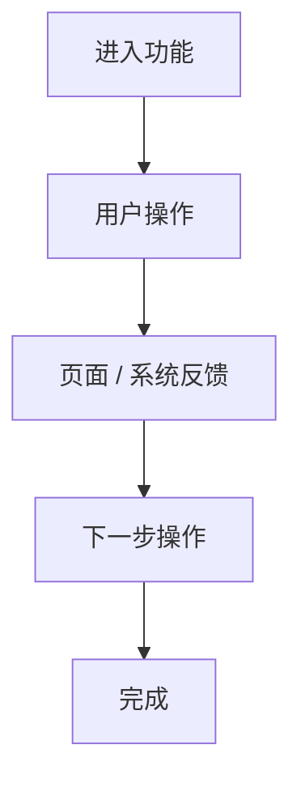
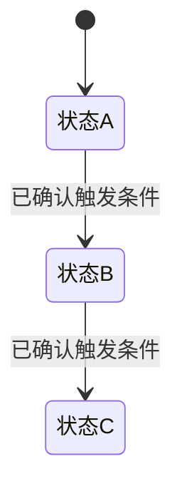
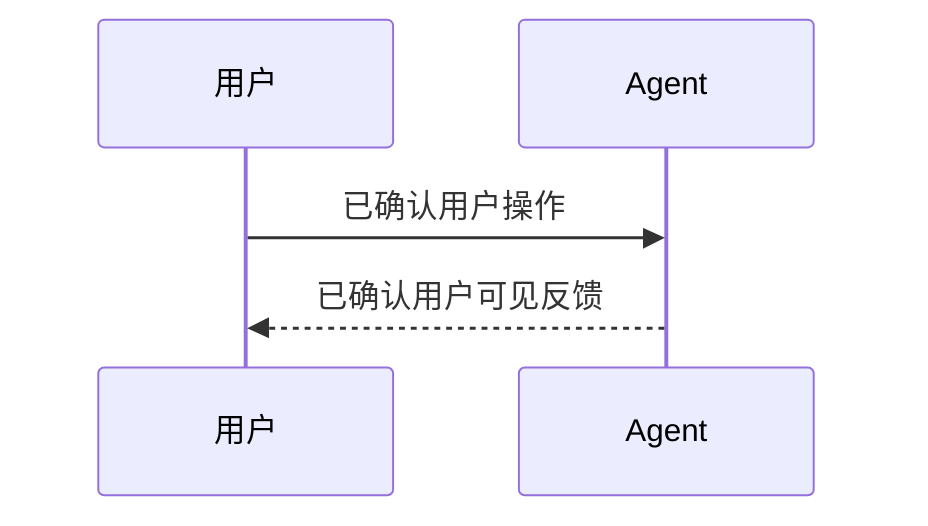

# 交互设计方案：[需求名称]

> UX ID：[UX-XXX]
> 文档版本：[v1.0]
> 文档状态：[草稿 / 已确认]
> 创建日期：[YYYY-MM-DD]
> 最后更新：[YYYY-MM-DD]

# 一、简要说明

> 本章节为所有交互产物必填。

## 1.1 设计目标

用 1–3 句话说明：

- 目标用户；
- 主要任务；
- 本次交互设计目标。

## 1.2 设计范围

列出本次实际涉及：

- 页面；
- 页面区域；
- 功能模块；
- 核心交互。

## 1.3 核心交互

概括用户从入口到完成主要任务的操作方式。

## 1.4 主要页面 / 区域

简要说明各页面 / 区域的功能定位。

## 1.5 设计依据

引用主要上游 Artifact / 对话 / 已确认方案。

---

# 二、交互方案

根据 PHASE 0 / PHASE 1 的复杂度判断选择一种路径。

---

## 路径 A：简单需求

### A1. ASCII Wireframe

当“页面长什么样”更重要时使用。

```text
+------------------------------------------------------+
| [页面标题]                            [操作]          |
+------------------------------------------------------+
| [导航 / 筛选 / 工具区]                               |
+------------------------------------------------------+
|                                                      |
| [主要内容区域]                                       |
|                                                      |
+------------------------------------------------------+
```

要求：

- 重点表达布局、层级和模块关系；
- 不追求视觉精度；
- 不为了“完整”加入上游未定义模块；
- 可用注释说明点击后去向。

### A2. Mermaid Flowchart

当“用户怎么走”更重要时使用。



要求：

- 只画已确认主流程；
- 只画已确认分支；
- 不自行补异常 / 失败 / 降级路径。

### A3. 两者同时使用

只有当页面布局和流程都对理解方案很重要时同时使用。

---

## 路径 B：复杂需求

### B1. HTML 交互原型

正式产物：

> [prototype.html 路径 / 链接]

要求：

- 可点击；
- 主要页面 / View 可进入；
- 关键交互可体验；
- 使用 mock 数据；
- 不连接真实生产接口；
- 只实现上游已确认的业务场景；
- 不创造异常 / 失败 / 降级业务分支；
- 视觉应参考当前产品上下文、现有页面或设计规范；
- 具体实现遵循 `assets/html-prototype-guideline.md`。

### B2. 可选辅助图

仅在有必要时增加：

- ASCII Wireframe；
- Mermaid Flowchart；
- Mermaid State Diagram；
- Mermaid Sequence Diagram。

State / Sequence 非必要不展示。

---

# 三、关键交互说明

按页面 / 区域组织。

## 3.1 [页面 / 区域名称]

### 功能定位

[说明]

### 页面结构

[说明]

### 主要操作

1. [用户操作]
   - [页面响应]
2. [用户操作]
   - [页面响应]

### 与其他区域 / 页面关系

[说明]

---

## 3.2 [下一个页面 / 区域]

按上述结构继续。

---

# 四、状态与时序图（条件章节）

> 仅在确有必要时生成。
>
> 若不需要，整章不生成。

## 4.1 Mermaid State Diagram

仅使用上游已明确状态。



不得自行增加异常 / 失败状态。

## 4.2 Mermaid Sequence Diagram

仅在多主体先后关系影响用户体验时生成。



不写底层 API / HTTP / 技术实现。

---

# 五、设计约束与说明

仅列与交互实现直接相关、且已有依据支持的约束，例如：

- 当前产品已有导航结构；
- 必须复用某组件；
- 仅支持桌面端 / 移动端；
- 某区域不可调整；
- 某流程必须保留。

不在这里创造新的业务规则。

---

# 六、待确认事项

> 条件章节。
>
> 仅当正式交互方案仍然存在真实待确认问题时生成。
>
> 若没有待确认问题，整章不生成。

| 序号 | 影响区域 | 待确认事项 | 建议 |
|---|---|---|---|
| 1 | [页面 / 流程] | [问题] | [建议] |

禁止主动添加上游未定义的异常 / 失败处理作为待确认项。
